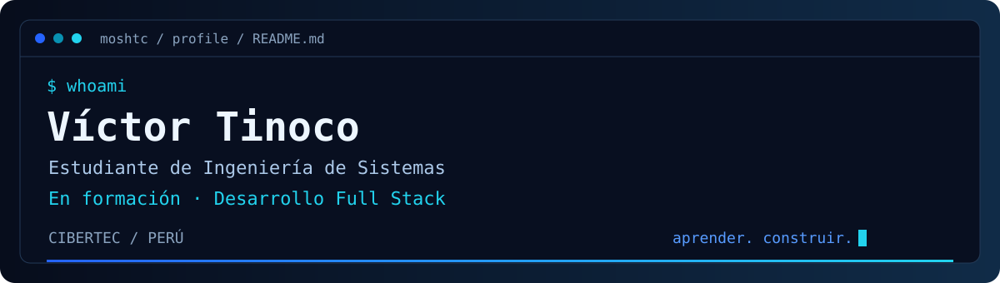

  

  <strong>Estudiante de Ingeniería de Sistemas · Aprendiendo Desarrollo Full Stack</strong> 
  Cibertec · Perú

  <a href="https://github.com/MoshTC/portafolio-victor">Portafolio</a> &nbsp;·&nbsp;
  <a href="https://github.com/MoshTC/respawn-store">Respawn Store</a> &nbsp;·&nbsp;
  <a href="https://github.com/MoshTC">GitHub</a>

## Hola, soy Víctor

Estoy construyendo mis bases en **Desarrollo Full Stack** mientras estudio **Ingeniería de Sistemas en Cibertec**. Aprendo creando proyectos, practicando y conectando la interfaz con la lógica y los datos de una aplicación.

Me interesa escribir código claro, crear interfaces adaptables y mejorar con cada proyecto. Aquí comparto mi portafolio y parte de mi aprendizaje académico.

> En formación: aprender → practicar → construir → mejorar.

## Stack en construcción

Tecnologías que utilizo en mis proyectos o estoy aprendiendo, sin atribuirme un nivel profesional.

- **Frontend:** HTML5 · CSS3 · JavaScript · Bootstrap.
- **Programación:** Java · PHP.
- **Datos:** SQL · MySQL · SQL Server.
- **Herramientas:** Git · GitHub · Visual Studio Code.

## Proyectos destacados

### 01 — Respawn Store

**Una tienda web con temática gaming.** Catálogo de consolas, videojuegos y accesorios, con secciones de comunidad y ayuda. Incluye navegación y pie de página compartidos entre páginas.

`HTML5` · `CSS3` · `JavaScript` · `Tabler Icons`

Proyecto académico del curso de Aplicaciones Web, desarrollado por **un equipo de 6 integrantes**. El resultado es un trabajo colectivo que comparto como parte de mi aprendizaje.

**[Explorar Respawn Store →](https://github.com/MoshTC/respawn-store)**

### 02 — portafolio-victor

**Mi espacio para compartir lo que construyo.** Portafolio web personal que reúne proyectos, tecnologías y mi recorrido de aprendizaje, con estructura estática y sin dependencias de Node.js.

`HTML5` · `CSS3` · `JavaScript`

**[Explorar el portafolio →](https://github.com/MoshTC/portafolio-victor)**

## En qué estoy trabajando

- Practicar interfaces responsive e interactividad con JavaScript.
- Reforzar programación orientada a objetos con Java y mis bases de PHP.
- Profundizar en consultas SQL y bases de datos relacionales.
- Mejorar la documentación y el trabajo con Git y GitHub.

---

  <strong>Una base sólida, un proyecto a la vez.</strong> 
  <a href="https://github.com/MoshTC">Encuéntrame en GitHub · @MoshTC</a>

